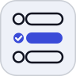

<div align="center">
  
</div>

# quiz-tools


Two skills that author quiz sets for `/quiz` and ship them hands-off — write and
self-check the set, then upload and publish it without touching a form.

Part of the [`quiz-app`](../README.md) repository — the app these quizzes are
published to.

[**Install (Claude Code)**](#install-claude-code) |
[**Install (DSH)**](#install-dsh) |
[**First run**](#first-run-per-machine) |
[**Usage**](#usage) |
[**Troubleshooting**](#troubleshooting) |
[**What it leaves on disk**](#what-it-leaves-on-disk)

## What it does

- **`quiz-create`** — writes a quiz-set JSON in the house style (varied difficulty,
  plausible distractors, hidden multi-correct counts) and self-validates it against
  the *same* validator the server runs, so a set that passes locally cannot be
  rejected on upload.
- **`quiz-upload`** — posts it to `/quiz/api/admin/sets` and optionally publishes.
  Handles the Cloudflare Access one-time-PIN login by itself: drives the browser,
  reads the code out of the mailbox, caches the session cookie for ~24 h.

Ask in plain language — "make me a quiz on Raft consensus", then "upload it" — or
run them directly as `/quiz-tools:quiz-create` and `/quiz-tools:quiz-upload`.

## Install (Claude Code)

```sh
claude plugin marketplace add akshayDev17/quiz-app
claude plugin install quiz-tools@quiz-app --scope user
```

Brings both skills **and** the Gmail MCP server the upload flow reads its login code
with. Try it without installing: `claude --plugin-dir ./quiz-app/tools`.

## Install (DSH)

```sh
dsh plugin --profile web add file:"$PWD/tools"
```

Restart `dsh web` to load the skills. On this harness the Gmail MCP is declared in
the DSH profile rather than by the plugin.

## First run

**On a second machine there is nothing to set up — copy two files.** The OAuth
client belongs to a Google *project* and the token belongs to the *account*, so both
already exist on the machine that works. Copying them is the whole setup: no Google
console, no browser, no consent screen.

```sh
scp <set-up-machine>:~/.gmail-quiz/gcp-oauth.keys.json ~/.gmail-quiz/
scp <set-up-machine>:~/.gmail-quiz/credentials.json   ~/.gmail-quiz/
```

Or let the script do it: `gmail_auth.py --copy-from <set-up-machine> --oauth … --credentials …`.

**Only if no machine has it yet**, create the client once — Google Cloud project,
enable the Gmail API, OAuth client of type **Desktop app**, download the JSON. That
is once per Google project, never once per machine.

Either way the mailbox then needs **authorising once per account** (not per machine,
if you copied the token): the skill starts the MCP's `auth` command, opens the
browser, and waits. Expect to pick the Google account and, if it says the app is
unverified, click **Advanced → Go to … (unsafe)** — the client is yours, just not
published.

Playwright needs no setup at all: the first browser step provisions it into
`~/.quiz/venv` (~100 MB, once).

## Usage

```
you:  make me a quiz on Raft consensus, hard, 20 minutes
      → quiz-create writes rafts-consensus-quiz.json and validates it

you:  upload it and publish
      → quiz-upload logs in if needed, imports it, publishes it
```

## What the plugin sets up, and what is still yours

| | Provisioned |
| --- | --- |
| Both skills | yes |
| Gmail MCP server definition | yes |
| Playwright and its Chromium | yes, on first use |
| The Gmail OAuth grant | guided — a human still clicks Allow |
| `gcp-oauth.keys.json` | **no** — created once per Google project, then copied to each machine |
| `python3`, `node`/`npx` | **no** — the only real prerequisites |

## Troubleshooting

| Symptom | Cause and fix |
| --- | --- |
| `port 3000 is in use` | The Gmail MCP hardcodes 3000 for its OAuth callback. Stop whatever holds it (`lsof -nP -iTCP:3000 -sTCP:LISTEN`) and retry. |
| Gmail tools error about credentials | Not authorised on this machine. Delete `~/.gmail-quiz/credentials.json` and let the skill re-run the auth. |
| "Google hasn't verified this app" | Expected for an unpublished client: **Advanced → Go to … (unsafe)**, then Allow. |
| `playwright not installed` and it will not install | No network, or no `python3` to build the venv. Install by hand: `pip install playwright && playwright install chromium`. |
| `session expired — re-run the login` | The cached Cloudflare cookie lapsed (24 h). Delete `~/.quiz/session.json` and upload again. |

## What it leaves on disk

| Path | What | Removed by uninstalling? |
| --- | --- | --- |
| `~/.quiz/venv/` | Playwright virtualenv | no — delete to reclaim ~100 MB |
| `~/.quiz/session.json` | cached Cloudflare Access cookie (~24 h) | no |
| `~/.quiz/access-browser/` | the browser profile the login step drives | no |
| `~/.gmail-quiz/` | OAuth client keys and token | no |

## Why two manifests

`skills/` is the only copy of the skills. DSH reads `plugin.json` plus a skill
provider (`lib/index.js`, `cordis.patch.yml`); Claude Code reads
`.claude-plugin/plugin.json` plus `.mcp.json`. Same skills, two thin shells.

## Licence

MIT — see the `license` field in [`package.json`](package.json).
